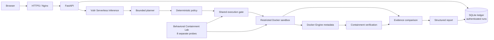

# DryRun AI

> **Understand what your Python code may do. Execute under controlled conditions. See exactly what the evidence proves.**

**Live demo:** <https://dryrun-ai-irfan.duckdns.org/>
**GitHub:** <https://github.com/IrfanKhan154/dryrun-ai>

DryRun AI is a focused pre-execution review tool for unfamiliar or
AI-generated Python. It combines Vultr Serverless Inference, bounded planning,
a deterministic execution policy, one restricted Docker run, and explicit
evidence trust tiers.

## 1. Problem

Reviewers often need to inspect Python before allowing it to run, but static
inspection alone cannot show what happened at runtime. Untrusted program output
can also look convincing without being independently verified. DryRun AI is
for developers, security reviewers, educators, and teams evaluating small
Python scripts before execution.

## 2. Product overview

DryRun AI analyzes source without executing it, asks an AI planner for bounded
questions, validates that plan against a fixed policy, and then performs one
bounded sandbox run for a normal submitted file. The report separates AI
predictions, execution facts, Docker configuration checks, comparisons, and
unknowns.

The public demo provides built-in samples. Public demo results are displayed
inline and are not persisted to shared run history. Public demo uploads, when
enabled, require the configured access code.

## 3. Key features

- Python source analysis through Vultr Serverless Inference.
- Bounded AI planning with one to five structured test cases.
- Deterministic policy validation independent of model instructions.
- Shared execution gate limiting concurrent sandbox runs.
- One bounded Docker execution for each normal submitted Python file.
- Host-side Docker Engine metadata inspection.
- Separate eight-case Behavioral Containment Lab.
- Evidence comparison that does not trust submitted-program event markers.
- Authenticated SQLite evidence ledger for workspace runs.
- Vanilla HTML, CSS, and JavaScript frontend with readable structured reports.

## 4. Six-stage agent workflow

1. **Analyze** — Vultr Serverless Inference predicts possible behavior from
   source without executing it.
2. **Plan** — a second Vultr Serverless Inference call creates one to five
   bounded questions.
3. **Policy** — the plan is validated against allowed focus areas and evidence
   sources.
4. **Execute** — the shared execution gate admits one run into the restricted
   Docker runner.
5. **Containment** — Docker configuration metadata is checked against nine
   expected restrictions.
6. **Compare** — predictions are compared only with available trusted evidence.

A planned test case is a question, not an automatic execution. In the current
normal analysis flow, one submitted Python file receives one bounded sandbox
run; planned cases are not individually executed.

## 5. Architecture



The Behavioral Containment Lab is a separate capability using the same
restricted runner. Its eight probes do not run during every normal analysis.

## 6. Technology stack

| Area | Technology |
|---|---|
| Application | Python, FastAPI |
| AI inference | Vultr Serverless Inference API |
| Orchestration | Bounded Python agent orchestration |
| Execution | Docker Engine, `python:3.12-slim` |
| Persistence | SQLite evidence ledger |
| Frontend | HTML, CSS, vanilla JavaScript |
| Edge | Nginx and HTTPS |
| Compute | Vultr Cloud Compute VM |

## 7. Vultr infrastructure and inference integration

The FastAPI application and its Nginx-facing deployment run on a Vultr Cloud
Compute VM. All application LLM calls use Vultr Serverless Inference through
the Vultr chat-completions endpoint: source analysis and bounded test planning
are separate requests using the configured inference model.

The Docker sandbox is an execution environment on the VM, distinct from
Vultr Serverless Inference. The model does not receive Docker commands or
control the sandbox policy.

## 8. Docker sandbox security model

The runner invokes a Python file with these source-defined restrictions:

- Network mode `none`.
- Read-only root filesystem.
- UID/GID `65534:65534`.
- All Linux capabilities dropped.
- `no-new-privileges`.
- 64-process limit.
- 128 MiB memory and 0.5 CPU limit.
- 64-file-descriptor limit and disabled core dumps.
- A 16 MiB writable `/tmp` tmpfs with `noexec` and `nosuid`.
- 15-second wall-clock timeout.
- Bounded stdout/stderr capture and host-side cleanup.

The nine Docker checks verify values reported by Docker Engine:

1. Network isolation
2. Read-only root filesystem
3. Non-root user
4. Capability drop
5. No-new-privileges
6. Memory limit
7. CPU limit
8. Process limit
9. Privileged mode disabled

These are configuration checks, not proof that each individual file, network,
or process operation was blocked.

## 9. Behavioral Containment Lab

The separate lab runs eight probes through the same restricted runner:

| Probe | Expected host-side observation |
|---|---|
| Normal script | Completes with exit code 0 |
| Network attempt | Fails under `network=none` |
| Write outside `/tmp` | Fails outside writable `/tmp` |
| Environment read | Completes without exposing values |
| Infinite loop | Times out at the sandbox limit |
| Memory hog | Is stopped by the memory limit |
| Process flood | Is stopped by the process limit |
| Forgery attempt | Program output remains untrusted |

Probe results are bounded observations, not a universal containment
certification.

## 10. Evidence trust model

| Trust tier | Meaning |
|---|---|
| Docker Engine metadata | Trusted for the narrow configuration or lifecycle facts Docker reports |
| Host runner | Trusted for bounded runner facts such as exit status, timeout, cleanup, and captured output |
| Program reported | Untrusted output from the submitted program; never host-verified |
| `predicted_not_observed` | The host did not have trusted evidence for a prediction; this does not prove impossibility |

Forged program markers cannot create host-confirmed evidence. Captured stdout
confirms output emission only; it does not prove that another operation
occurred.

## 11. Data persistence and privacy

Authenticated workspace runs are stored in SQLite as ledger records including
run metadata, findings, stage status, evidence summaries, and containment
checks. Uploaded source code is not stored in the ledger; the database stores
a source hash and size for authenticated runs.

Public demo results are never persisted to shared history. API keys and access
codes are supplied through headers or environment configuration and are not
documented with real values.

## 12. Installation and local setup

Requirements: Python 3.12-compatible runtime, Docker Engine, and access to
the configured Vultr inference service.

```bash
python3 -m venv venv
./venv/bin/python -m pip install -r requirements.txt
cp .env.example .env
# Set local values in .env; never commit that file.
./venv/bin/python -m uvicorn main:app --host 127.0.0.1 --port 8000
```

Open <http://127.0.0.1:8000/> after the service starts. Production Nginx,
HTTPS, CSP, security headers, and sandbox settings are deployment concerns and
are not changed by local setup.

## 13. Environment configuration

`.env.example` contains variable names only:

| Variable | Purpose |
|---|---|
| `VULTR_INFERENCE_API_KEY` | Server-side credential for Vultr inference |
| `DRYRUN_API_KEY` | Authenticates normal workspace API requests |
| `DRYRUN_DB_PATH` | Optional SQLite database path |
| `DEMO_MODE` | Enables public demo endpoints when set to `true` |
| `ACCESS_CODE` | Enables and protects public demo uploads |

Keep `.env` out of Git. The repository `.gitignore` also excludes virtual
environments, logs, and SQLite database files.

## 14. API endpoints

| Method | Endpoint | Access |
|---|---|---|
| `GET` | `/` | Public frontend |
| `GET` | `/health` | Public health check |
| `GET` | `/demo/samples` | Demo mode only |
| `POST` | `/demo/analyze/{sample_id}` | Demo mode; rate-limited; not persisted |
| `POST` | `/analyze` | Workspace API key, or demo upload access code |
| `POST` | `/containment/probes` | Workspace API key; public demo mode may run without one |
| `GET` | `/runs` | Workspace API key |
| `GET` | `/runs/{run_id}` | Workspace API key |

Requests are subject to the existing shared execution gate, request controls,
and daily caps.

## 15. Testing

Run the repository’s verified test command:

```bash
./venv/bin/python -m unittest discover -s tests -v
```

The suite covers orchestration, AI response validation, policy decisions,
Docker metadata verification, containment probes, database behavior, API
behavior, request controls, and schemas. It also includes test-only negative
harness cases proving that weakened network, timeout, and process-limit
expectations fail.

## 16. Security limitations

DryRun AI does not prove that code is safe. It does not provide complete
operation-level telemetry for every file, process, or network action, and a
prediction not observed is not proof that the operation was impossible.

Docker shares the host kernel and cannot establish protection against every
kernel-level escape. Docker metadata checks verify configuration claims, not
all runtime effects. The production runner supports Python only and disables
network access. Reports describe bounded evidence from one run, not a
certification or replacement for a full security review.

See [SECURITY.md](./SECURITY.md) for reporting guidance and security
boundaries.

## 17. Hackathon challenge alignment

For Vultr Agent Rush Hackathon 2026, Challenge 1: **Blast Radius Zero**, DryRun
AI demonstrates a constrained agent workflow: inference is separated from
execution, the planner cannot alter the deterministic policy, the runner is
resource- and network-bounded, and reports distinguish predictions from
trusted observations. The project intentionally states what remains unknown
instead of presenting containment as a guarantee.
